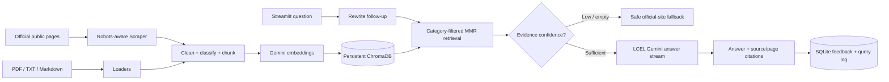

# INVERIS-CAMPUS-ASSISTANT-

# Invertis Campus Assistant

A bilingual-friendly Retrieval-Augmented Generation (RAG) chatbot for public Invertis University information. It indexes official public pages and user-supplied documents, answers from retrieved evidence, and displays citations. If evidence is missing or retrieval confidence is low, it declines to guess and points users to the official website.

> Information is from public university sources; please verify important details with the university.

## Architecture



## Project layout

```text
app.py                       Streamlit UI and protected admin tab
invertis_bot/config.py       Pydantic settings and environment configuration
invertis_bot/scraper.py      Same-host robots-aware crawler and JSON cache
invertis_bot/loaders.py      ABC, web/PDF loaders, category inference
invertis_bot/processing.py   Text cleanup and lazy chunk generation
invertis_bot/vectorstore.py  Persistent Chroma index and MMR search
invertis_bot/rag.py          LCEL rewrite/answer pipeline, memory, fallback
invertis_bot/feedback.py     SQLite feedback and question analytics
invertis_bot/ingest.py       Ingestion CLI
```

## Setup

Requires Python 3.11 or newer.

1. Create and activate a virtual environment.
2. Install dependencies: `pip install -r requirements.txt`.
3. Copy `.env.example` to `.env`, add a Google AI Studio API key as `GOOGLE_API_KEY`, and set a strong `ADMIN_PASSWORD` if admin features are needed. Do not commit `.env`.
4. Add optional `.pdf`, `.txt`, or `.md` reference files under `data/documents/`. PDFs are page-indexed for citations.
5. Build the index (initial scraping requires network access and a configured Gemini API key):

   `python -m invertis_bot.ingest --rebuild`

   The crawler requests `robots.txt` first, refuses to crawl if its rules cannot be verified, stays on the configured university host, follows allowed URLs only, waits between uncached requests, and caps crawl volume. It saves clean page records to `data/raw/university_pages.json` and caches HTML under `data/raw/.cache/`.

   To index already-collected sources without network requests:

   `python -m invertis_bot.ingest --rebuild --no-scrape`

6. Start the chat app: `streamlit run app.py`.
7. Run tests without a live API key: `pytest -q`.

### Refreshing data

Run `python -m invertis_bot.ingest --rebuild --refresh-cache` to clear the page cache and rebuild from fresh public pages plus local documents. A rebuild requires working Google Gemini embeddings. The cache reduces repeated requests; delay and page cap can be configured in `.env`.

### Configuration

Settings are in `.env.example` and validated by Pydantic. Model IDs, crawl delay/timeouts/page cap, chunk size/overlap, retrieval category/top-k/confidence threshold, memory length, database and data locations are configurable. The index and data paths default to the project `data/` directory.

`ENABLE_GEMINI=true` uses Gemini for fluent answer generation. Set it to `false` to use immediate extractive answers from retrieved source passages when Gemini is unavailable or its free-tier quota is exhausted. Citations remain visible in either mode.

## Example questions

- “How can I apply for admission?”
- “BCA ke liye eligibility kya hai?”
- “What is the current fee for the MCA programme?”
- “And its fees?” (follow-up to a course question)
- “Hostel and transport fees kya hain?”
- “What placement support is available?”
- “Where can I find examination results?”
- “How do I contact the university?”

Answer completeness depends on sources actually crawled or uploaded. For precise fee, eligibility, date, and result questions, check the source citation before acting.

## Admin features

The Admin tab asks for the `ADMIN_PASSWORD` configured in `.env`. Authorized users can upload PDFs/text/Markdown, trigger a fresh crawl and index rebuild, review recent ratings, and see aggregated popular questions. Uploads are stored by basename under `data/documents/`. Feedback/query records are in `data/feedback.sqlite3`.

## Safety and limitations

- Only public same-host HTML URLs are crawled; robots rules are checked before each request. Linked file downloads are not automatically crawled. Add official PDFs manually when appropriate.
- Text-only PDF extraction cannot read image-only/scanned PDFs; OCR is not included.
- Website changes, blocked networks, Gemini availability/quotas, and embedding API changes can affect ingestion and chat.
- Retrieval thresholds are heuristic; validate citations and adjust using the university corpus.
- Prompt injection in user questions and retrieved content is explicitly treated as untrusted. This is a student project, not an official university system.
- SQLite stores questions and short answer excerpts for feedback analytics. Use a managed privacy policy before public deployment.
- Gemini calls send the user question and retrieved context to the configured Google service; disclose this to users before deployment.

## Tests

The pytest suite exercises cleanup/chunk metadata, LRU caching, retries, memory trimming, citation generation, and safe low-confidence fallbacks using fake retrievers and model doubles. No real API key is needed.
